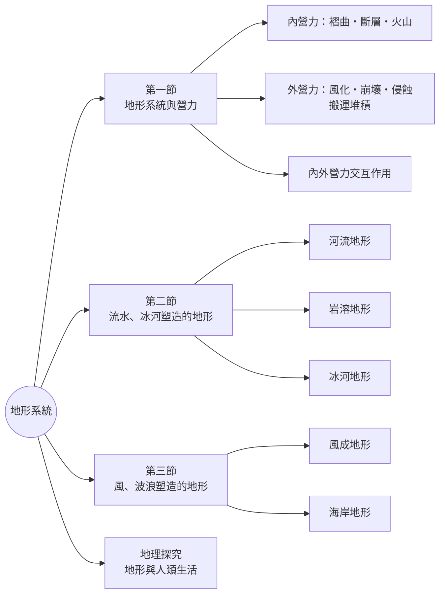

# 0. 導論：地形系統與人地關係

[TOC]

## 🎯 本章學習目標

完成本章後，你應該能夠：

1. 用「**投入 → 作用過程 → 產出**」的系統觀點，說明地形如何形成與改變。
2. 區分**內營力**與**外營力**，並舉出各自造成的地形。
3. 辨識流水、岩溶、冰河、風、海水所塑造的主要地形，並能判讀其**等高線示意圖**。
4. 分析不同地形環境帶給人類的**資源**與**災害**，思考永續利用的方式。

## 🌊 引導故事：從「台江內海」到「七股潟湖」

想像一下 300 多年前的臺南：今天的**七股區、安南區**一帶，曾是船隻往來的**台江內海**。

這個例子告訴我們：

- 地形系統的**投入**（河流帶來的泥沙）或**作用過程**（改道、攔沙）一旦改變，地形就會跟著改變。
- 同一個變化，對人類可能**先是資源、後是災害**，或兩者並存。

:::success
**📍 現場觀察**：曾文溪出海口北岸的**國聖燈塔**是臺灣本島最西端，位於頂頭額沙洲上；沙洲與陸地之間圍出的水域就是**七股潟湖**，居民多利用這片半封閉水域經營養殖漁業。
🗺️ [在 Google 地圖上查看國聖燈塔](https://www.google.com/maps/search/?api=1&query=國聖燈塔)
:::

## 🤔 本章核心提問

| 情境 | 好處（資源） | 要注意的風險（災害） |
|---|---|---|
| 在山區開公路 | 交通運輸更方便 | 邊坡崩塌、落石 |
| 海邊奇岩發展觀光 | 獨特景觀吸引遊客 | 瘋狗浪等海岸危險 |
| 河口新生地開墾 | 增加可耕地 | 地勢低窪易淹水 |

> 了解地形系統怎麼運作，才能在「利用」與「避災」之間找到平衡，走向**環境永續**。

## 🗺️ 本章架構

---
➡️ 下一篇：[1-1 地形系統與營力：內營力](/@USERNAME/geo-ch4-02)
