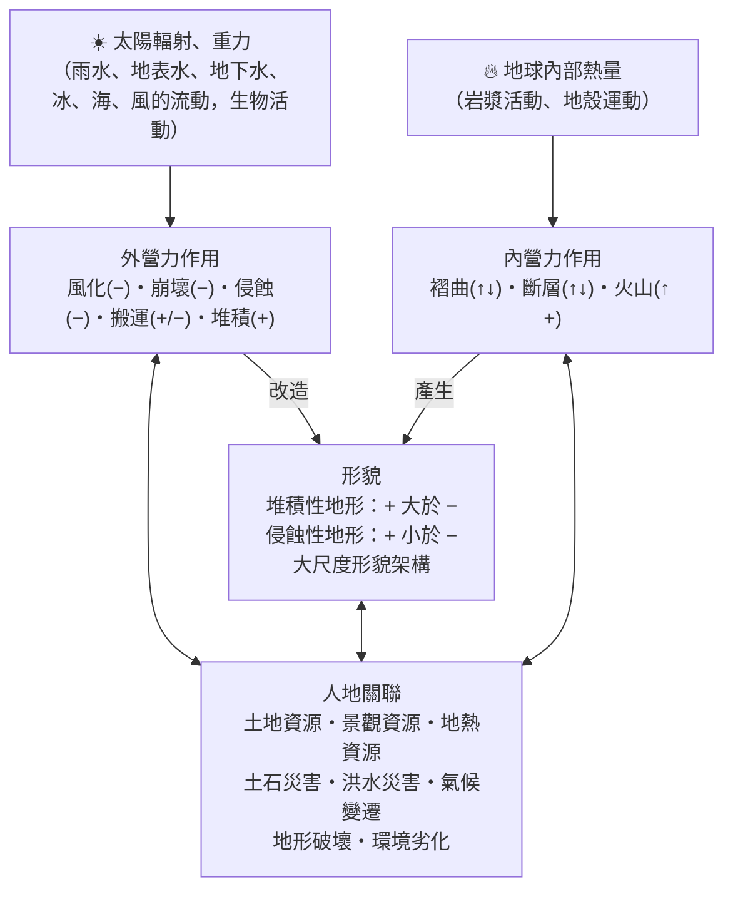
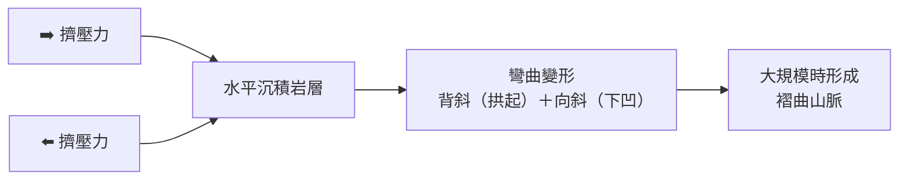
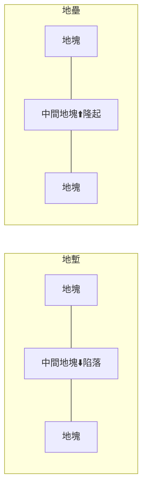
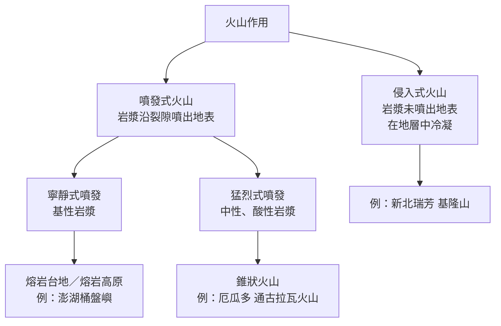

# 1-1 地形系統與營力：內營力

[TOC]

## 一、地表的舞臺：各種尺度的地形

地表是人類活動的舞臺，起伏形態多樣：

| 尺度 | 例子 |
|---|---|
| **大尺度** | 山地、高原、盆地、丘陵、平原 |
| **小尺度** | 沙丘、蕈狀岩、碎石坡、鐘乳石 |

## 二、什麼是「地形系統」？

**系統**：一組共同運作的物體或現象，各組成單元之間透過**能量**與**物質**的流動彼此連結。

把這個概念套用到地形上：

- **地球內部熱能** → 驅動岩漿活動、地殼運動
- **太陽輻射＋重力** → 驅動大氣圈、水圈中的水、冰、風、海水流動與生物活動

這些能量造成各種**營力作用**，改變地表形貌，形成不同的地形景觀；而地形又會回過頭來影響人類——可能是**資源**，也可能是**限制**；人類活動同樣會改變地形系統中的物質、能量與作用過程。

### 📊 地形系統運作圖

:::info
**圖例說明**
- **＋** 物質輸入（面積或高度增加）　**−** 物質輸出（面積或高度減少）
- **↑** 地勢抬升　**↓** 地勢沉降
- 雙向箭頭：彼此「改變與影響」
:::

## 三、內營力 vs. 外營力

| 比較 | 內營力 | 外營力 |
|---|---|---|
| 能量來源 | 地球內部熱能 | 太陽能、重力 |
| 媒介 | 岩漿活動、地殼運動 | 水、冰、海、風、生物 |
| 作用方式 | 褶曲、斷層、火山 | 風化、崩壞、侵蝕、搬運、堆積 |
| 影響範圍 | 通常較廣大 | 局部、持續地雕塑 |
| 對地形的角色 | 建立地表的**基本架構** | 對架構進行**雕塑改造** |

### 影響地形的其他因素
除了營力，**岩層構造的差異**與**演育時間的長短**，也會塑造出不同空間尺度的地形——大到一整條山脈、小到一面峭壁，各有自己的地形系統。

### 🔍 用「空間尺度」看沙丘
以非洲西南部的沙丘為例，從小到大放大視野，會問出不同層次的問題：

| 尺度 | 觀察對象 | 可以提出的問題 |
|---|---|---|
| 小 | 單一座沙丘 | 這座沙丘多高？會移動嗎？為什麼上面沒有植物？ |
| ↓ | 沙丘群 | 沙從哪裡來？風如何塑造出這些沙丘形態？只有沙漠才有沙丘嗎？ |
| ↓ | 區域（非洲西南部） | 為什麼沙丘集中在這裡？ |
| 大 | 整個大陸 | 為什麼沙漠分別出現在北非和西南非？其他大陸也一樣嗎？ |

---

## 四、內營力與地形演育

內營力源自**地函對流**，帶動地殼板塊移動，進而造成：
- 岩層扭曲變形 → **褶曲**
- 岩層斷裂錯動 → **斷層**
- 引發岩漿活動 → **火山地形**

內營力塑造了大尺度的地表架構，成為外營力作用的「底稿」。

> 例：美國西北部的**哥倫比亞高原**是火山熔岩堆成的高原，後來再被河流切割出峽谷——先有內營力的架構，再有外營力的雕塑。

### （一）褶曲作用

- **褶曲**：沉積岩層受到**擠壓**，彎曲成波浪狀。
  - 向上拱起的部分：**背斜**
  - 向下凹的部分：**向斜**
- 造山運動時，板塊擠壓常形成大範圍的**褶曲山脈**：山勢高聳崎嶇，常是河流的發源地。
  - 例：**臺灣中央山脈**、**喜馬拉雅山脈**、**洛磯山脈**、**安地斯山脈**

:::warning
**📚 小百科：新褶曲山脈 vs. 古老結晶陸塊**
| 類型 | 形成時間 | 地表特徵 |
|---|---|---|
| **新褶曲山脈** | 約 3,500 萬年前以來形成 | 受外營力作用時間較短 → **地勢起伏大** |
| **古老結晶陸塊** | 約 2 億 8 千萬年前以前形成 | 長期被侵蝕，殘留堅硬的火成岩與變質岩 → **地表起伏小** |
:::

### （二）斷層作用

- **斷層**：岩層受力**斷裂**，斷裂面兩側的地塊發生**錯動**。
- 當地殼承受的力超過岩層的承受限度，就會以斷層的方式釋放能量 → 造成地殼震動，也就是**地震**。

| 斷層地形 | 形成方式 | 例子 |
|---|---|---|
| **斷層崖** | 斷裂面兩側地塊出現高度落差，落差可達數百至數千公尺 | 臺灣**蘇澳—花蓮**間的海岸（清水斷崖一帶） |
| **地塹** | 兩斷層之間的地塊相對**陷落** | **東非大地塹** |
| **地壘** | 兩斷層之間的地塊相對**隆起** | 中國**天山山脈** |

#### 🇹🇼 臺灣的斷層
- 臺灣位於**菲律賓海板塊**與**歐亞板塊**的交界帶，受板塊擠壓，形成許多**大致呈南北走向**的斷層，地震頻繁。
- **921 大地震（1999）**：車籠埔斷層東側抬升，在臺中霧峰（光復國中操場）形成明顯的**斷層崖**，現保存為地震教育園區。
- 斷層是地殼的裂隙，也可能成為岩漿上升的通道，因此**火山活動有時與斷層有關**。

:::success
🗺️ **線上踏查**
- [921 地震教育園區（車籠埔斷層崖）](https://www.google.com/maps/search/?api=1&query=921地震教育園區)
- [清水斷崖](https://www.google.com/maps/search/?api=1&query=清水斷崖)
- 📎 臺灣活動斷層分布可查詢：[經濟部地質調查及礦業管理中心](https://www.gsmma.gov.tw/)
:::

### （三）火山作用

**火山作用**多與板塊運動密切相關：在**板塊隱沒處**或**板塊張裂處**，常見火山分布（例如環太平洋火山地震帶）。火山噴出的熔岩可形成火山體，噴發過程也會讓碎屑物四散堆積。

依岩漿是否噴出地表，分為兩大類：

#### 1. 侵入式火山：基隆山的形成
1. 原本是水平的沉積岩層。
2. 岩漿侵入岩層中，把上方沉積岩頂起，並在地下冷凝成火山體。
3. 上方沉積岩經風化、侵蝕被移除，**原本埋在地下的火山體裸露出來** → 基隆山。

#### 2. 噴發式火山：寧靜式 vs. 猛烈式

| 比較 | 寧靜式噴發 | 猛烈式噴發 |
|---|---|---|
| 岩漿性質 | **基性** | **中性、酸性** |
| 二氧化矽含量 | 低 | 高 |
| 黏度 / 流動性 | 黏度小、流動性大 | 黏度大、流動性小 |
| 氣體 | 容易散逸，少爆裂 | 不易散逸，壓力累積 → **爆裂噴發** |
| 形成地形 | 熔岩漫流 → 大面積平坦的**熔岩台地**、**熔岩高原** | 碎屑與熔岩堆積 → **錐狀火山** |
| 例子 | 澎湖**桶盤嶼**玄武岩台地（柱狀節理） | 厄瓜多**通古拉瓦火山** |

:::info
**火口湖**：火山口若積水，就形成火口湖，例如印尼**克里穆圖火山**的三色湖。在等高線圖上，火山口呈現「外高內低」的封閉等高線。
:::

#### 3. 火山活動帶來的危害與資源

| | 內容 | 例子 |
|---|---|---|
| ⚠️ **危害** | 火山灰使大氣能見度變差，影響**飛航安全** | 2010 年冰島火山爆發，歐洲航班大亂 |
| ⚠️ **危害** | 碎屑物、熔岩掩埋聚落 | 西元 79 年義大利**維蘇威火山**噴發，鄰近的**龐貝城**被火山灰掩埋 |
| ✅ **資源** | 火山灰化育的土壤富含礦物質，利於農作 | 越南的火山農業 |
| ✅ **資源** | 地熱：暖氣、溫室、**地熱發電**（綠色能源） | 冰島、臺灣宜蘭清水地熱 |
| ✅ **資源** | 噴氣孔的硫磺結晶，早期是製作火藥的原料 | 陽明山**小油坑**噴氣孔 |

:::success
🗺️ **線上踏查**
- [基隆山（侵入式火山）](https://www.google.com/maps/search/?api=1&query=基隆山+瑞芳)
- [澎湖桶盤嶼（玄武岩柱狀節理）](https://www.google.com/maps/search/?api=1&query=桶盤嶼)
- [陽明山小油坑](https://www.google.com/maps/search/?api=1&query=小油坑)
:::

---

## ✅ 隨堂小測

1. 內營力的能量來自哪裡？會形成哪三類作用？
2. 地塹與地壘的差別是什麼？各舉一例。
3. 為什麼基性岩漿的火山比較不會爆炸？

:::spoiler 💡 參考答案
1. 地球內部熱能（地函對流）；褶曲、斷層、火山。
2. 地塹：兩斷層間地塊相對陷落（東非大地塹）；地壘：兩斷層間地塊相對隆起（天山山脈）。
3. 基性岩漿二氧化矽含量低、黏度小、流動性大，氣體容易散逸，壓力不易累積，因此多為寧靜式噴發。
:::

---
⬅️ [0. 導論](/isvincent/geo-ch4-01)　｜　➡️ [1-2 外營力與交互作用](/isvincent/geo-ch4-03)
