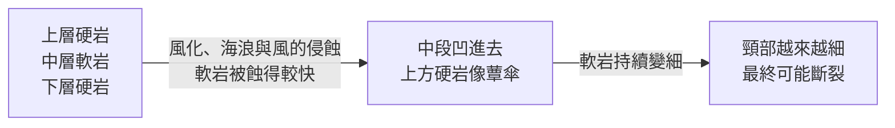

# 🧪 學生活動 4-1　女王頭的歲月痕跡

## 📌 情境

新北市萬里區的**野柳地質公園**，假日總是擠滿排隊要和「女王頭」合影的遊客。不過學者發現，女王頭從**民國 58 年**到現在，外形已明顯改變，「脖子」越來越細——**民國 107 年**量得頸圍約 **124.6 公分**，未來可能面臨斷頸。

園區裡另一座頸圍約 256 公分的蕈狀岩，被遊客票選為女王頭的「接班人」，命名為「俏皮公主」。

:::success
🗺️ [野柳地質公園](https://www.google.com/maps/search/?api=1&query=野柳地質公園) ——找一找女王頭的位置，並比對不同年份的街景或網路照片。
:::

## 🔬 蕈狀岩怎麼形成？

## ✍️ 請你回答

1. 女王頭屬於哪一種**空間尺度**的地形？
2. 比較民國 58、69、79、107 年的照片，女王頭外形變化最大的是哪個部位？
3. 女王頭屬於**蕈狀岩**地形。參考上方的形成過程，分析造成蕈狀岩的主要原因。
4. 依蕈狀岩的形成過程推估，女王頭的頸部可能在未來 10～15 年內斷裂。你認為我們應該**用科技延長它的壽命**，還是**順應自然、任其消失**？請說明理由。

:::spoiler 🧑‍🏫 教師參考
1. 小尺度地形。
2. 頸部（變得越來越細），頭部輪廓也因風化而改變。
3. **差異侵蝕**：岩層軟硬相間，上方硬岩抗蝕力強，中段軟岩受風化、海浪與風的侵蝕較快而內凹。
4. 開放性問題。可引導學生從**自然演育**、**觀光價值**、**保存成本與技術**、**地景保育的倫理**等面向思考。
:::

---
⬅️ [1-2 外營力與交互作用](/@USERNAME/geo-ch4-03)　｜　➡️ [2-1 陸地上的流水與河流地形](/@USERNAME/geo-ch4-05)
