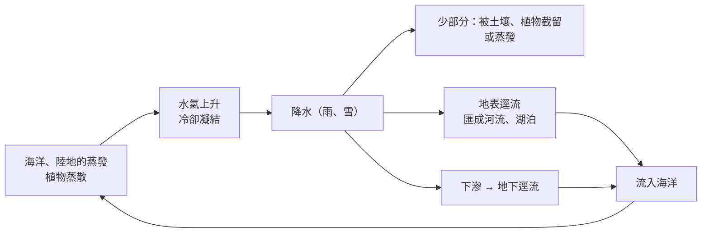

# 2-1 陸地上的流水與河流地形

[TOC]

> **第二節導讀**：太陽輻射推動水循環，降到陸地的水在地表與地下持續作用，形成**河流地形**與**岩溶地形**；在高緯度與高山，降水以雪為主，積雪成冰河，塑造出**冰河地形**。

## 一、陸地上的流水

**降水、地表逕流、地下逕流**的運動過程，都會造成地形的改變。

---

## 二、河流作用

降雨形成地表逕流後，就開始對岩石與土壤進行**侵蝕、搬運、堆積**，塑造**河流地形**（峽谷、瀑布、山麓沖積扇、氾濫平原、三角洲、曲流、河階……）。

### 影響流速的因素
- 地勢落差 **越大** → 流速越快
- 河道 **越窄** → 流速越快
- 流量 **越大** → 流速越快

### 河谷演育的三個方向

| 名稱 | 方向 | 作用 | 結果 |
|---|---|---|---|
| **向源侵蝕（頭蝕）** | 往上游 | 源頭不斷崩塌後退 | 河流**變長** |
| **下蝕** | 往下 | 刻蝕河床 | 河谷**變深** |
| **側蝕** | 往兩側 | 沖刷兩側谷壁 | 河道**變寬** |

### 搬運與堆積
當流速降低、流量減少，或攜帶的物質太多時，就會發生**堆積**——常見於**谷口**與**河口**。

:::warning
**📚 小百科：侵蝕基準面**
河流下蝕有最低限度，稱為**侵蝕基準面**：
- **暫時基準**：流入的河、湖或**水庫水面**
- **最終基準**：**海平面**

當海平面與陸地的相對高度改變，侵蝕基準面也會跟著變，進而改變河流的下蝕力。
:::

---

## 三、河流地形

### （一）上、中、下游的河谷變化

| 河段 | 地勢與流速 | 主要作用 | 河谷形態（剖面） |
|---|---|---|---|
| **上游** | 起伏大、流速快 | **向源侵蝕、下蝕** | 窄而深的 **V 形谷**、**峽谷** |
| **中游** | 起伏漸緩 | **側蝕**為主 | 河谷逐漸開闊 |
| **下游** | 地勢平坦 | **堆積**旺盛 | 寬廣平淺，河道蜿蜒 |

#### 峽谷
- 例：**花蓮立霧溪峽谷**（太魯閣）。
- 峽谷兩岸窄、坡陡、谷深，在地質條件許可下，常是**興建水壩**的優先考量地點。

### （二）瀑布

河流流經陡峭、落差大的地形時形成**瀑布**（例：**新北平溪十分瀑布**）。

**造成陡峭落差的原因**：斷層作用、主支流侵蝕速度差異、岩層差異侵蝕。

- 瀑布水流湍急、侵蝕力強 → **瀑布後退**
- 落下的水流下蝕力大 → 形成**深潭**

### （三）山麓沖積扇

河流從山區進入平原 → 落差變小、河幅變寬、流速變慢 → 上游帶來的碎屑在**谷口**大量堆積，形成**扇狀地形**。

| 部位 | 沉積物 | 水文 | 土地利用 |
|---|---|---|---|
| **扇頂、扇央** | 砂礫粗、孔隙大、透水性佳 | 地表水易下滲成地下水，**缺水** | 開發較晚，多**旱作**（果園等） |
| **扇端** | 顆粒較細 | 地下水帶狀湧出 → **湧泉帶** | 水源充足、灌溉便利，多**水稻**；**聚落**發展早 |

- 例：屏東萬巒鄉**五溝水**（因位於扇端、湧泉充足而得名）、南投信義鄉羅娜村。
- ⚠️ 大雨引發**山洪、土石流**時，谷口的沖積扇首當其衝。

**等高線判讀**：以谷口為中心，向外呈**同心圓弧狀**、間距由密變疏。

### （四）氾濫平原與三角洲

- **氾濫平原**：下游地勢平坦，洪水溢出河道時，泥沙堆積在河流兩側（例：紐西蘭**懷馬卡里里河**）。
- **三角洲**：河流入海，流速驟降，堆積大於侵蝕而形成。

**人地關係**：
- ✅ 世界古文明多在大河兩岸——地勢平、土壤肥、引水便，在沖積扇、氾濫平原、三角洲開墾並建灌溉系統（例：幼發拉底河與底格里斯河的**美索不達米亞平原**）。
- ⚠️ 地勢低平，水患風險高（例：2005 年**卡崔娜颶風**，密西西比河三角洲上的**紐奧良**大淹水）。

### （五）曲流與牛軛湖

**曲流**形成原因：
- 山區河流遇到堅硬岩層，流路受阻而繞道；或
- 氾濫平原地勢平坦開闊，河道容易左右擺動。

| 河岸 | 位置 | 作用 | 特徵與利用 |
|---|---|---|---|
| **基蝕坡（凹岸）** | 河道凹側 | 河水直接衝擊 → **侵蝕** | 水深、岸陡、向陸地後退；常作**港口** |
| **滑走坡（凸岸）** | 河道凸側 | 水流緩 → **堆積** | 淺灘、河岸地，地勢平坦；適合**農耕** |

**牛軛湖的形成**：

- 例：波蘭**瓦爾塔河**。

### （六）河階

**成因**：陸地**抬升**，或**侵蝕基準面下降** → 河流重新下蝕 → 舊河床被抬高到新河道之上，形成**階梯狀地形**。

- **河階面**：平坦、近水源、與河道落差大不易淹水 → 適合**居住、農耕**
- **河階崖**：階面之間的陡坡
- 例：**桃園大溪**——聚落分布於不同高度的河階面上。

**等高線判讀**：等高線「疏（階面）—密（階崖）」交替出現。

:::success
🗺️ **線上踏查**
- [立霧溪峽谷（太魯閣）](https://www.google.com/maps/search/?api=1&query=太魯閣燕子口)
- [十分瀑布](https://www.google.com/maps/search/?api=1&query=十分瀑布)
- [屏東萬巒五溝水](https://www.google.com/maps/search/?api=1&query=五溝水)
- [桃園大溪河階](https://www.google.com/maps/search/?api=1&query=大溪老街) ——用地形圖層觀察大漢溪兩岸的階梯
:::

---

## ✅ 隨堂小測

1. 向源侵蝕、下蝕、側蝕分別讓河谷產生什麼變化？
2. 為什麼沖積扇的扇端多水田、扇頂多果園？
3. 曲流的凹岸、凸岸，哪一側適合建港？哪一側適合耕作？
4. 河階形成的兩種原因是什麼？

:::spoiler 💡 參考答案
1. 向源侵蝕使河流延長；下蝕使河谷加深；側蝕使河道加寬。
2. 扇頂、扇央砂礫粗、透水性強，地表缺水，只能旱作；扇端地下水湧出成湧泉帶，水源充足適合種稻。
3. 凹岸（基蝕坡）水深適合建港；凸岸（滑走坡）地勢平坦、有堆積，適合耕作。
4. 陸地抬升；侵蝕基準面（如海平面）下降。
:::

---
⬅️ [學生活動 4-1](/isvincent/geo-ch4-04)　｜　➡️ [2-2 岩溶作用與岩溶地形](/isvincent/geo-ch4-06)
