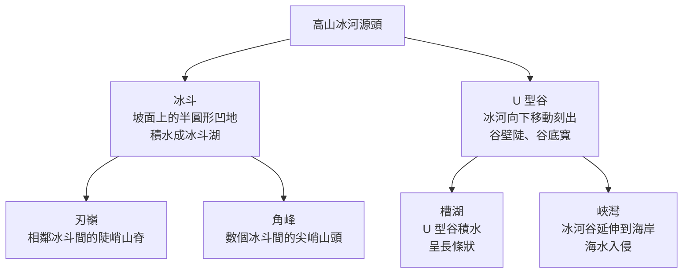
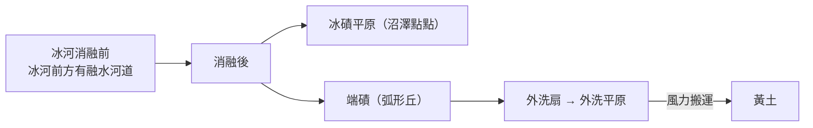

# 2-3 冰河作用與冰河地形

[TOC]

- 在**冰河時期**，冰河覆蓋的範圍非常廣，是許多地區重要的地形塑造力量。
- 目前地球陸地約有 **10%** 被冰河覆蓋，主要在**格陵蘭、南極洲**與高山地區（如青藏高原、阿拉斯加、安地斯山脈南段），對**高緯度**與**高山**地區的地形仍有相當影響。

## 一、冰河作用

### 冰河的形成

- 例：美國阿拉斯加的**肯尼科特冰川**。

### 冰蝕與冰積

| 作用 | 方式 | 說明 |
|---|---|---|
| **冰蝕** | **磨蝕** | 冰河與夾帶的岩塊，刮磨底岩或谷壁 |
| **冰蝕** | **拔蝕** | 冰河移動時，把冰床底部或谷壁的岩塊「拔」走 |
| **冰積** | 冰河**直接堆積** | 冰河消融後留下大小混雜的岩塊 |
| **冰積** | 冰融**流水沉積** | 融冰水再搬運、分選後堆積 |

---

## 二、冰河地形

### （一）冰蝕地形（高山冰河）

| 地形 | 特徵 | 例子 |
|---|---|---|
| **冰斗**、冰斗湖 | 冰河源頭坡面的半圓形凹地；積水成湖（屬冰蝕湖） | 美國阿拉斯加 |
| **刃嶺** | 相鄰冰斗之間的陡峭山脊 | 阿爾卑斯山 |
| **角峰** | 數個冰斗之間的尖峭山頭 | 阿爾卑斯山**馬特洪峰** |
| **U 型谷** | 谷壁陡峭、谷底寬平；常是**交通孔道** | 阿爾卑斯山南北兩側透過 U 型谷往來 |
| **槽湖** | U 型谷中的長條狀湖泊（屬冰蝕湖） | 加拿大**沛托湖** |
| **峽灣** | 冰河消融、海平面上升，海水入侵冰河谷；水深浪靜、是良好避風港 | **挪威**蓋朗厄爾峽灣；與**維京人**的航海文化密切相關 |
| **冰蝕平原** | 大陸冰河大範圍拔蝕、磨蝕後留下的平坦地面；**土壤淺薄**，不利農業 | 北歐、加拿大地盾 |

:::info
**🆚 V 型谷 vs. U 型谷**：河流下蝕造成「窄底」的 V 型谷；冰河整體刨蝕造成「寬底」的 U 型谷。看到寬平谷底配上兩側陡壁，就要想到冰河。
:::

**等高線判讀**：角峰為密集尖頂；刃嶺為狹長密集的脊線；冰斗是朝下坡開口的半圓形凹陷；U 型谷兩側等高線密、谷底等高線疏且呈 U 形。

### （二）冰積地形（大陸冰河）

大陸冰河移動到緯度較低處，氣溫升高、冰雪補給有限，搬運能力下降，攜帶的土石就堆積下來：

| 地形 | 形成 | 沉積物特徵 / 人地關係 |
|---|---|---|
| **冰磧** | 冰河直接堆積 | **大小混雜、沒有層理** |
| **端磧** | 堆在冰河前緣的冰磧丘 | 例：格陵蘭 |
| **冰磧平原** | 冰磧構成的緩起伏地形 | 土壤夾雜大小岩屑，低窪處多**沼澤** → 整地困難 |
| **冰底隧道** | 冰層消融的水在冰層底部流動的通道 | 例：冰島藍冰洞 |
| **外洗扇** | 融冰水切穿端磧，把細小岩屑堆成扇狀 | 沉積物**粒徑較一致、成層堆積** |
| **外洗平原** | 融冰水沉積成的平坦地 | 同上；例：美國阿拉斯加 |
| **黃土** | 外洗平原的細粒物質再被**風**搬到他處堆積 | **肥沃**，利於農業；例：德國、波蘭中部的黃土台地 |

### （三）歐洲第四紀冰河時期

北歐是當時歐洲北方大陸冰河的**覆蓋中心**。冰河消融後，**由北往南**依序可見：

> **冰蝕區** →（冰河最大範圍附近）**冰積平原** → **外洗平原** → **黃土**

- 冰蝕區：北歐斯堪地那維亞
- 冰積、外洗平原：北德平原、波蘭
- 黃土：德國、波蘭中部到烏克蘭

:::success
🗺️ **線上踏查**
- [馬特洪峰（角峰、刃嶺）](https://www.google.com/maps/search/?api=1&query=Matterhorn)
- [加拿大沛托湖（U 型谷、槽湖）](https://www.google.com/maps/search/?api=1&query=Peyto+Lake)
- [挪威蓋朗厄爾峽灣](https://www.google.com/maps/search/?api=1&query=Geirangerfjord)
- [美國阿拉斯加肯尼科特冰川](https://www.google.com/maps/search/?api=1&query=Kennicott+Glacier)
- 臺灣高山也有冰河遺跡：[雪山圈谷](https://www.google.com/maps/search/?api=1&query=雪山圈谷)
:::

---

## ✅ 隨堂小測

1. 磨蝕與拔蝕有什麼不同？
2. 冰磧和外洗平原的沉積物有什麼差別？為什麼？
3. 為什麼北歐的農業條件不如德國、波蘭中部？

:::spoiler 💡 參考答案
1. 磨蝕：冰河與夾帶岩塊刮磨底岩；拔蝕：冰河把冰床或谷壁岩塊拔起帶走。
2. 冰磧由冰河直接堆積，大小混雜、無層理；外洗平原由融冰流水搬運，經過分選，粒徑較一致且成層。
3. 北歐為冰蝕區，冰蝕平原土壤淺薄；德國、波蘭中部有風力堆積的肥沃黃土。
:::

---
⬅️ [2-2 岩溶地形](/@USERNAME/geo-ch4-06)　｜　➡️ [學生活動 4-2 地形系統運作](/@USERNAME/geo-ch4-08)
