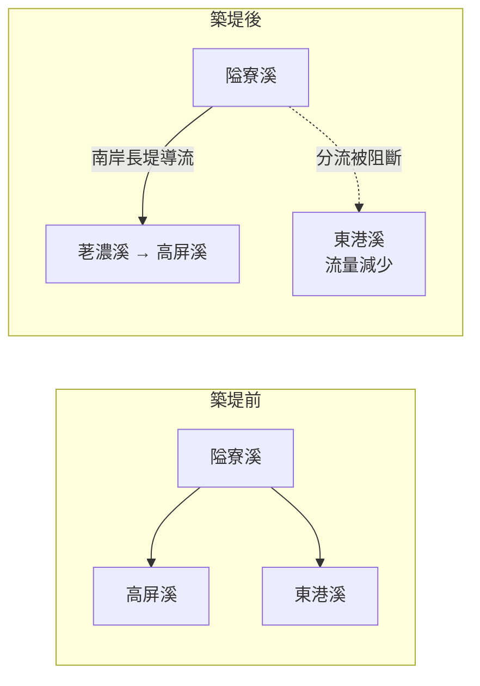

# 🧪 學生活動 4-2　地形系統運作——屏東平原

## 📌 情境

- **屏東平原**位於臺灣南部，東側以**潮州斷層**與**中央山脈**相鄰。斷層附近發育了好幾個**沖積扇**與**階地**，由北往南呈帶狀分布。
- 平原北部的**隘寮溪**向西流出中央山脈時，在谷口堆出面積廣大的沖積扇。早年扇面上分流很多：一部分向西注入**高屏溪**，一部分向西南注入**東港溪**。
- 因為每逢豪雨，沖積扇上常因河水氾濫成災，日治時期**昭和 13 年（1938 年）**，官方從扇頂修築南岸長堤，把隘寮溪導向西北，注入高屏溪上游的**荖濃溪**，使隘寮溪成為荖濃溪的支流；之後又陸續阻斷隘寮溪流向東港溪的分流，**東港溪流量因此減少**。

:::success
🗺️ [屏東平原與潮州斷層一帶（三地門、青山）](https://www.google.com/maps/search/?api=1&query=屏東+三地門+隘寮溪) ——切換衛星圖，觀察隘寮溪出谷口後的沖積扇與東側山麓的階地。
:::

## ✍️ 請你回答

**1.** 調查發現，屏東平原上方的階地分布在**潮州斷層以東**的山谷出口。這些階地的形成，和斷層東側地塊的哪一種作用有關？
- [ ] 抬升
- [ ] 沉降

**2.** 潮州斷層附近新、舊沖積扇的形成，主要來自不同時期中央山脈供應的土石泥沙。在河流流出山谷**之前**，中央山脈地形區內發生的哪些外營力作用，有助於供應這些土石泥沙？（可複選）
- [ ] 風化
- [ ] 崩壞
- [ ] 侵蝕
- [ ] 搬運
- [ ] 堆積

**3.** 對照[地形系統運作圖](/@USERNAME/geo-ch4-02)，東港溪出海口附近的海岸線多年來向內陸後退。隘寮溪南岸長堤使東港溪流量減少、搬運能力下降，輸出到河口的泥沙變少，是海岸後退的原因之一。這個關聯主要是哪個面向的改變造成的？
- [ ] 人為活動改變**外營力**，進而影響形貌變化
- [ ] 人為活動改變**內營力**，進而影響形貌變化

:::spoiler 🧑‍🏫 教師參考
1. **抬升**：斷層東側地塊相對抬升，使原本的沖積扇面被抬高，河流重新下切，形成階地。
2. **風化、崩壞、侵蝕、搬運**：山區岩石先風化破碎，經崩壞與侵蝕產生土石，再由河流搬運出谷口；「堆積」發生在谷口的沖積扇上，而不是出谷之前的供應過程。
3. **人為活動改變外營力**：築堤改變河川流路與流量（流水營力），使泥沙輸出減少，進而影響海岸形貌。
:::

---
⬅️ [2-3 冰河地形](/@USERNAME/geo-ch4-07)　｜　➡️ [3-1 風力作用與風成地形](/@USERNAME/geo-ch4-09)
