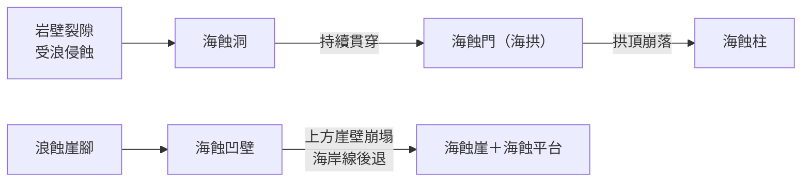

# 3-2 海水作用與海岸地形

[TOC]

## 一、海水作用

**海岸地帶**是陸地與海洋的交會處。海水受風吹拂形成**波浪**，再配合沿岸的**海流**與**潮汐**，持續對海岸進行侵蝕、搬運與堆積。

:::warning
**📚 小百科：海岸地帶的名詞**
| 名詞 | 意義 |
|---|---|
| **海岸線** | 海崖頂部、沙丘高坡的連線，或最大暴風浪在陸地上能到達的界線 |
| **濱線** | 海面與陸地的交界線；海平面因潮汐升降，濱線也隨之移動 |
| **前濱（潮間帶）** | 高潮濱線與低潮濱線之間的陸地；沙岸、珊瑚礁海岸的潮間帶通常較寬 |
| **後濱** | 海岸線到高潮濱線之間 |
| **海濱區** | 從海岸線到低潮濱線的整個區域（＝後濱＋前濱） |
:::

---

## 二、海岸地形

### （一）海蝕地形——多在岩岸

波浪主要沿著**岩石破裂面**或**岩性較弱處**侵蝕。

#### 1. 岬灣海岸
- 例：**臺灣東北角**——軟、硬岩交錯排列 → **岬角**與**灣澳**交替出現。
- **灣澳**形勢較封閉、受浪衝擊小，常作為船隻避風的港口並發展聚落（例：新北貢寮**澳底**，可避冬季東北季風）。
- **等高線判讀**：岬角是向海突出的舌狀等高線；剖面呈中間高、兩側低。

#### 2. 海蝕小地形
多半因部分岩層抗蝕力較弱而形成，造型特殊，常是重要**觀光資源**。

| 地形 | 形成 | 臺灣例子 |
|---|---|---|
| **海蝕洞** | 沿岸岩壁裂隙受浪侵蝕，破裂面持續擴大 | 宜蘭**龜山島**眼鏡洞 |
| **海蝕門（海拱）** | 海蝕洞被貫穿，形成拱門狀 | 新北瑞芳**象鼻岩** |
| **海蝕柱** | 海中礁石持續被浪拍擊，剩下柱狀岩塊 | 屏東**小琉球花瓶岩** |
| **海蝕崖** | 海岸岩壁被波浪侵蝕成陡崖 | 新北瑞芳**鼻頭角** |
| **海蝕凹壁** | 海蝕崖下方被浪持續淘蝕而凹陷 | 新北瑞芳鼻頭角 |
| **海蝕平台** | 凹壁持續內凹 → 上方崖壁反覆崩塌、海岸後退 → 崖腳前方留下平台 | 澎湖**七美小臺灣** |

### （二）海積地形——多在沙岸

波浪推上陸地的細沙、礫石，**多於**帶離陸地的數量時，就形成海積地形。

| 地形 | 特徵 | 例子 |
|---|---|---|
| **海灘** | 海濱的礫灘或沙灘，多為水上遊憩區；沙源充足、風強處，後方常形成沙丘 | 澎湖馬公**嵵裡海灘** |
| **沙嘴** | 與陸地相連的沙洲，前緣沿海流方向延伸 | 新北貢寮**福隆** |
| **潮埔** | 海底平淺處，高、低潮濱線相距很遠，細泥堆積成寬廣潮間帶；利於**養蚵** | 彰化**芳苑** |
| **濱外沙洲** | 沙礫在海底堆高、露出海面，位於海岸外且大致平行海岸線 | 雲林口湖**外傘頂洲** |
| **潟湖** | 濱外沙洲與海岸圍成的半封閉淺水域；多作**養殖漁業** | 臺南**七股潟湖** |

- **潮埔**地勢平坦、面積廣大，常發展**養殖業**，或**填海造陸**開發成工業區（例：雲林麥寮**六輕石化工業區**）。

#### 臺灣西部海岸的變遷

### （三）離水海岸與沉水海岸

| 類型 | 成因 | 代表地形 | 例子 |
|---|---|---|---|
| **離水海岸** | 陸地相對**上升**或海平面相對**下降** | **海階**（舊海蝕平台被抬升成階面）、高出海面的舊海蝕洞 | 花蓮豐濱**新社海階**、臺東長濱**八仙洞** |
| **沉水海岸** | 陸地相對**下沉**或海平面相對**上升** | 山嶺變島嶼、山脊變岬角、山谷變**谷灣**；冰河谷沉水成**峽灣** | 谷灣：中國**福建、浙江**沿海；峽灣：**挪威** |

> 💡 **臺灣東部海岸**多離水地形，因為位於板塊擠壓帶、陸地持續抬升。

**等高線判讀**：
- 海階：靠海側出現「密（新海蝕崖）—疏（階面）」交替的階梯狀等高線。
- 谷灣：海岸線曲折、島嶼多，等高線延伸入海呈犬牙交錯。
- 峽灣：狹長深入內陸的水道，兩側等高線非常密集（谷壁陡峭）。

:::success
🗺️ **線上踏查**
- [象鼻岩（海蝕門）](https://www.google.com/maps/search/?api=1&query=深澳象鼻岩)
- [小琉球花瓶岩（海蝕柱）](https://www.google.com/maps/search/?api=1&query=花瓶岩+小琉球)
- [七美小臺灣（海蝕平台）](https://www.google.com/maps/search/?api=1&query=七美+小台灣)
- [福隆沙嘴](https://www.google.com/maps/search/?api=1&query=福隆海水浴場)
- [外傘頂洲（濱外沙洲）](https://www.google.com/maps/search/?api=1&query=外傘頂洲)
- [八仙洞（離水海岸）](https://www.google.com/maps/search/?api=1&query=八仙洞遺址)
:::

---

## ✅ 隨堂小測

1. 海蝕洞 → 海蝕門 → 海蝕柱，代表什麼過程？
2. 濱外沙洲與潟湖的關係是什麼？潟湖常被如何利用？
3. 為什麼八仙洞的海蝕洞會高掛在海岸山壁上？
4. 為什麼近年臺灣西部有些海岸反而出現侵蝕後退？

:::spoiler 💡 參考答案
1. 波浪持續侵蝕的演育順序：裂隙擴大成洞 → 洞被貫穿成拱 → 拱頂崩落剩下柱。
2. 濱外沙洲與海岸之間圍出的半封閉水域就是潟湖；水淺，多作養殖漁業。
3. 臺灣東部陸地持續抬升（離水海岸），原本在海邊形成的海蝕洞被抬到高處。
4. 河流上游興建水壩攔截泥沙，海岸沙源供應不足。
:::

---
⬅️ [3-1 風成地形](/@USERNAME/geo-ch4-09)　｜　➡️ [學生活動 4-3 桃園海岸的變遷](/@USERNAME/geo-ch4-11)
