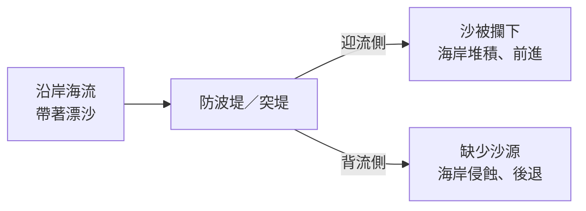

# 🔎 地理探究：地形系統——地形與人類生活

[TOC]

🔓 **知識解鎖：地形變遷**

## 一、地形不只是資源，也是精神象徵

| 面向 | 例子 |
|---|---|
| **精神文化** | 日本**富士山**被視為聖山；臺灣雪山山脈的**大霸尖山**被部分**泰雅族**與**賽夏族**人視為祖先發源地、聖地 |
| **觀光資源** | 壯麗或奇特的地形景觀，如陽明山國家公園的火山地形（磺嘴山） |

## 二、地形變遷的速度與規模

| 營力 | 規模 | 速度 | 例子 |
|---|---|---|---|
| 板塊擠壓的造山運動 | 範圍可達數千公里 | **很慢**（數百萬年） | 山脈隆起 |
| 火山噴發、斷層 | 範圍較小 | **很快** | 地震造成斷層崖 |
| 外營力（快） | 局部 | 肉眼可見的顯著改變 | 颱風、洪水、暴浪 |
| 外營力（慢） | 局部 | 需透過**環境監測**才能發現 | 潛移、海岸緩慢後退 |

## 三、人為活動也會改變地形

人口增加、科技發展、產業活動，都可能加速地形變遷、提高災害風險：

- **港口防波堤** → 突堤效應 → 海岸變遷
- **山區開路** → 方便又能賞景，但帶來山崩、落石隱憂
- **超抽地下水** → 地層下陷（例：雲林口湖沿海低窪地帶，早期發展養殖業，地層下陷後遇雨常積水不退）
- **占用河岸** → 2009 年**莫拉克颱風**，臺東卑南鄉知本溪暴漲，**凹岸**建物地基被淘空而倒塌

:::warning
**📚 小百科：突堤效應**
大型海岸結構物（如港口防波堤）垂直突出於海岸，擋住了沿岸流與漂沙的路徑：
- **迎海流（上游）側**：泥沙被攔下 → **堆積**
- **背海流（下游）側**：漂沙減少、短缺 → **侵蝕**
:::

### 🌏 思考：臺灣該怎麼利用地形資源？

臺灣**人口密集、山多平原少**，土地資源非常珍貴，完全禁止開發並不實際。關鍵在於：

1. **了解**各種地形演育的特性與限制；
2. **避免**大規模或加速地形變遷的不合理開發；
3. 透過多方評估，**降低**地形變遷對人類的影響與危害。

---

## 四、活動 GO～ 地名裡的地形

### 1️⃣ 理解知識

人們為了生活，會考量**安全、用水、避風、耕種、交通**等因素，選擇適合的地形環境建立聚落、開墾、修路，並常用當地的地形特徵來命名。例如：

| 地名 | 地形字詞 | 意義 |
|---|---|---|
| 新北市貢寮區 **澳**底 | 澳 | 海灣 |
| 臺南市南區 下**鯤鯓** | 鯤鯓 | 海邊的沙洲（形似鯨魚的背） |
| 花蓮縣豐濱鄉 石梯**坪** | 坪 | 平坦地（海水侵蝕後再經離水作用形成的**海階**） |

### 2️⃣ 填寫表格（小組活動）

使用 **1904 年《臺灣堡圖》**（可在「臺灣百年歷史地圖」網站疊圖查看）與圖例，判讀下列地名：

1. 地名中哪個字代表地形特徵？代表什麼意義？
2. 透過地圖判斷，當地主要的地形類型與營力作用是什麼？
3. 聚落的區位與這種地形的哪項優勢有關？可能發展哪些產業？
4. 這種地形環境可能面臨什麼災害或發展限制？

**📋 討論紀錄表（範例）**

| 項目 | 澳底（新北市貢寮區） |
|---|---|
| 地形字詞 | **澳** |
| 1. 字詞意義 | 海灣 |
| 2. 地形類型與營力 | 灣澳；海水差異侵蝕作用 |
| 3. 地形優勢／產業 | 灣澳可避風／漁業 |
| 4. 潛在災害或限制 | 大浪或暴潮；聚落背後緊鄰山區，腹地有限 |

**📋 請完成以下四個地名**

| 項目 | 四鯤鯓 （臺南市南區） | 灣仔 （臺北市中山區） | 三層 （桃園市大溪區） | 沙崙 （桃園市大園區） |
|---|---|---|---|---|
| 地形字詞 | | | | |
| 1. 字詞意義 | | | | |
| 2. 地形類型與營力 | | | | |
| 3. 地形優勢／產業 | | | | |
| 4. 潛在災害或限制 | | | | |

:::spoiler 🧑‍🏫 教師參考（僅供引導，可依堡圖判讀調整）
| 項目 | 四鯤鯓 | 灣仔 | 三層 | 沙崙 |
|---|---|---|---|---|
| 字詞 | 鯤鯓 | 灣 | 層 | 崙 |
| 意義 | 海岸沙洲 | 河流彎曲處 | 階梯狀的層次 | 沙丘、小土丘 |
| 地形與營力 | 濱外沙洲；海水堆積 | 曲流（凸岸堆積）；河流作用 | 河階；河流下蝕＋陸地抬升 | 海岸沙丘；風力（及海水）堆積 |
| 優勢／產業 | 近潟湖與海，漁業、養殖、鹽業 | 凸岸地勢平坦，農耕 | 河階面平坦、近水不易淹，聚落與農耕 | 沙地可種植耐旱作物、漁業 |
| 災害／限制 | 暴潮、海岸侵蝕、沙洲變遷 | 洪水氾濫、河道擺動 | 河階崖崩塌、取水較不便 | 飛沙、海岸侵蝕、土壤貧瘠 |
:::

### 3️⃣ 撰寫報告（延伸思考）

搜尋一個**自家附近**與地形有關的地名，利用《臺灣堡圖》與衛星影像：
1. 說明其地形特徵；
2. 分析形成這個地形的**營力**；
3. 評估它具備的**地形資源**、**發展限制**與**潛在災害**；
4. 提出可能的**防範作法**，寫成一份個人報告（可作為學習歷程成果）。

**🔗 參考網站與 web GIS 平臺**
- [內政部地名資訊服務網](https://gn.moi.gov.tw/)
- [臺灣百年歷史地圖（中研院）](https://gissrv4.sinica.edu.tw/gis/twhgis/)
- [國家災害防救科技中心　災害潛勢地圖](https://dmap.ncdr.nat.gov.tw/)

---
⬅️ [學生活動 4-3](/isvincent/geo-ch4-11)　｜　➡️ [總複習](/isvincent/geo-ch4-13)
