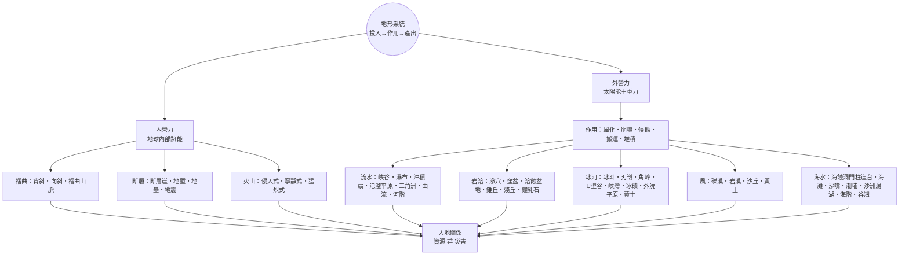

# 📝 總複習：概念圖、名詞索引與自我評量

[TOC]

## 一、全章概念圖

## 二、地形「判讀口訣」

| 地形 | 等高線／剖面特徵 |
|---|---|
| 峽谷（上游） | 等高線 V 字密集指向上游，剖面窄深 |
| 山麓沖積扇 | 以谷口為圓心的同心弧線，間距由密變疏 |
| 氾濫平原 | 等高線稀疏、河道分汊 |
| 河階 | 等高線疏密交替（階面疏、階崖密） |
| 火口湖 | 外高內低的封閉等高線 |
| 滲穴、窪盆 | 封閉的凹陷等高線 |
| 錐丘 | 密集的封閉等高線，頂部有高程點 |
| 冰斗、角峰、刃嶺 | 半圓形凹陷、尖頂、狹長密集脊線 |
| U 型谷 | 谷壁密、谷底疏，呈 U 形 |
| 岬角 | 向海突出的舌狀等高線 |
| 海階 | 靠海側出現階梯狀疏密交替 |
| 谷灣 | 海岸曲折、多島嶼 |

## 三、名詞索引

| 名詞 | 一句話定義 | 所屬 |
|---|---|---|
| 地形系統 | 營力投入 → 作用過程 → 地形產出的整體運作 | 1-1 |
| 內營力 | 源自地球內部熱能的營力（褶曲、斷層、火山） | 1-1 |
| 外營力 | 源自太陽能與重力的營力（風化、崩壞、侵蝕、搬運、堆積） | 1-2 |
| 褶曲 | 沉積岩層受擠壓而彎曲成波浪狀 | 1-1 |
| 斷層 | 岩層斷裂且兩側地塊錯動 | 1-1 |
| 地塹／地壘 | 兩斷層間地塊相對陷落／隆起 | 1-1 |
| 侵入式火山 | 岩漿未噴出、在地下冷凝，後因侵蝕裸露 | 1-1 |
| 熔岩台地 | 基性岩漿寧靜噴發、漫流凝固成的平坦地形 | 1-1 |
| 錐狀火山 | 中酸性岩漿猛烈噴發、碎屑與熔岩堆成 | 1-1 |
| 物理風化 | 岩石原地碎裂，成分不變 | 1-2 |
| 化學風化 | 岩石起化學反應，成分改變而分解 | 1-2 |
| 潛移 | 極緩慢的土壤下滑 | 1-2 |
| 土石流 | 含水量高、混合巨石泥沙的快速流動體 | 1-2 |
| 差異侵蝕 | 岩層軟硬不同造成侵蝕速度差異 | 1-2 |
| 向源侵蝕 | 河流源頭後退、河道延長 | 2-1 |
| 侵蝕基準面 | 河流下蝕的最低限度（最終為海平面） | 2-1 |
| 湧泉帶 | 沖積扇扇端地下水湧出處 | 2-1 |
| 基蝕坡／滑走坡 | 曲流凹岸（侵蝕）／凸岸（堆積） | 2-1 |
| 牛軛湖 | 曲流截彎取直後舊河道積水成的湖 | 2-1 |
| 河階 | 河流重新下蝕留下的階梯狀舊河床 | 2-1 |
| 岩溶作用 | 酸性水溶解石灰岩中的碳酸鈣 | 2-2 |
| 伏流 | 潛入地下流動的河水 | 2-2 |
| 磨蝕／拔蝕 | 冰河刮磨底岩／拔走岩塊 | 2-3 |
| 冰磧 | 冰河直接堆積，大小混雜無層理 | 2-3 |
| 外洗平原 | 冰融水沉積，粒徑一致且成層 | 2-3 |
| 黃土 | 細粒物質經風搬運後在下風處堆積 | 2-3、3-1 |
| 礫漠／岩漠 | 風蝕後剩礫石／露出底岩 | 3-1 |
| 潮間帶（前濱） | 高、低潮濱線之間 | 3-2 |
| 潟湖 | 濱外沙洲與海岸圍成的半封閉水域 | 3-2 |
| 離水海岸 | 陸地相對上升或海面相對下降 | 3-2 |
| 沉水海岸 | 陸地相對下沉或海面相對上升 | 3-2 |
| 突堤效應 | 突堤迎流側堆積、背流側侵蝕 | 探究 |

## 四、自我評量

**1.** 下列何者屬於內營力作用？
(A) 凍融 (B) 斷層 (C) 潛移 (D) 拔蝕

**2.** 澎湖桶盤嶼的玄武岩台地，其岩漿最可能具有哪些性質？
(A) 二氧化矽含量高、黏度大 (B) 二氧化矽含量低、流動性大 (C) 酸性岩漿、易爆裂 (D) 未噴出地表即冷凝

**3.** 某地居民發現坡地上的樹木基部普遍向坡下彎曲、電線桿傾斜，最可能是哪一種崩壞？
(A) 潛移 (B) 地滑 (C) 土石流 (D) 落石

**4.** 屏東五溝水聚落位於沖積扇的哪個部位？為什麼適合種稻？

**5.** 下列哪一組地形**都**與冰河作用有關？
(A) 角峰、峽灣、外洗平原 (B) 錐丘、刃嶺、沙嘴 (C) 牛軛湖、冰斗、潮埔 (D) 河階、槽湖、滲穴

**6.** 臺東長濱八仙洞的海蝕洞位於高出海面的山壁上，說明此地屬於何種海岸？成因為何？

**7.** 某港口興建突堤後，突堤北側海灘變寬、南側海灘變窄，則當地沿岸流的方向最可能為何？

**8.** 為什麼石灰岩地區的農地多集中在溶蝕盆地？

:::spoiler 💡 參考答案
1. **(B)**。凍融為物理風化、潛移為崩壞、拔蝕為冰蝕，皆屬外營力。
2. **(B)**。寧靜式噴發的基性岩漿二氧化矽低、黏度小、流動性大，漫流成熔岩台地。
3. **(A)**。
4. **扇端**。扇端地下水湧出成湧泉帶，水源充足、灌溉便利。
5. **(A)**。錐丘、滲穴屬岩溶；沙嘴、潮埔屬海積；牛軛湖、河階屬河流。
6. **離水海岸**。陸地相對上升（或海平面相對下降），使原本位於海邊的海蝕洞被抬高。
7. **由北向南**。迎流側（北側）堆積、背流側（南側）侵蝕。
8. 岩溶區的風化物貧瘠且地表水易滲漏；溶蝕盆地地勢低平、土壤較易堆積、近水源。
:::

---
⬅️ [地理探究](/@USERNAME/geo-ch4-12)　｜　🏠 [回到書本目錄](/@USERNAME/geo-ch4)
